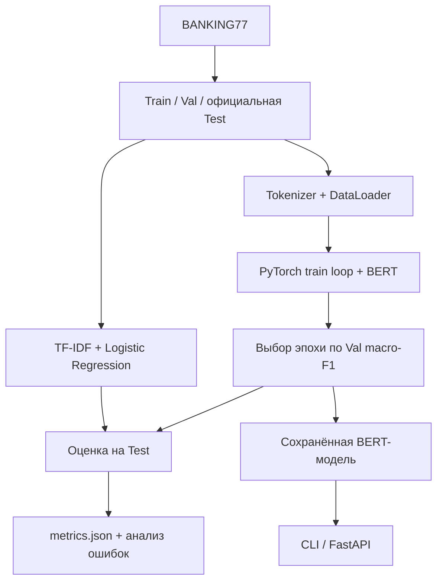

# Banking BERT Lab

**Python · PyTorch · Transformers · BERT · scikit-learn · FastAPI · Macro-F1**

Учебный ML-проект: сравнение классической модели **TF-IDF + Logistic Regression** с **дообученным BERT** для классификации намерений клиентов банка. Главная цель — показать, как организовать аккуратный ML-эксперимент: **данные → разбиение → baseline → собственный PyTorch train loop → оценка → анализ ошибок → локальное API**.

> **Статус:** исходники, PyTorch train loop, подготовка датасета, тесты и инструкции готовы. **BERT пока не дообучался в среде сборки проекта:** здесь нет загруженных весов и датасета Hugging Face. В README нет выдуманных значений accuracy или macro-F1. После реального обучения результаты появятся в `artifacts/banking_bert/metrics.json`.
>
> **Это не production-модель банка.** Датасет — публичный англоязычный BANKING77. Проект не содержит реальных персональных банковских данных и не является коммерческим внедрением.

## Какую проблему решает проект

Клиенты пишут в поддержку о задержках переводов, неработающих картах, комиссиях и других проблемах. Автоматическая классификация может помогать **маршрутизировать обращения** к нужной группе. Для банковской предметной области важно не только общее accuracy: модель должна различать близкие категории ошибок, поэтому в экспериментах основная метрика — **macro-F1**. Предусмотрен флаг `review_required` при низком softmax-score: это эвристика для ручной проверки, а не откалиброванная вероятность.

## Что реализовано

| Компонент | Реализация |
|---|---|
| Датасет | [PolyAI/BANKING77](https://huggingface.co/datasets/PolyAI/banking77): 77 категорий, официальные train/test |
| Учебный быстрый запуск | 8 банковских категорий; ограничение количества записей на класс, фиксированный seed |
| Разделение выборок | Train / validation из официального train, test берётся **только из официального test** |
| Baseline | TF-IDF, 1–2-граммы, Logistic Regression (scikit-learn) |
| BERT | [google/bert_uncased_L-2_H-128_A-2](https://huggingface.co/google/bert_uncased_L-2_H-128_A-2), небольшой предобученный BERT-энкодер |
| PyTorch | `DataLoader`, `AdamW`, `zero_grad`, `loss.backward`, `step`, clipping градиентов, scheduler |
| Выбор модели | Лучшая эпоха BERT по **validation macro-F1**, тестирование после выбора |
| Анализ | Accuracy, macro-F1, precision/recall/F1 по каждому классу, CSV с ошибками |
| Inference | Сохранение модели и токенизатора; CLI и необязательный REST API через FastAPI |
| Качество | 28 офлайн-тестов при установленном PyTorch; GitHub Actions для Python 3.11/3.12 (без PyTorch пропускает тесты train loop) |

Главная идея: **не использовать готовый Hugging Face `Trainer`**. Цикл обучения реализован в `banking_bert_lab/train_loop.py`, чтобы можно было объяснить каждую операцию на техническом собеседовании.

## Архитектура



## Запуск без Docker — Google Colab (рекомендуется)

Если не хочется настраивать тяжёлое окружение на Windows, используй [`notebooks/Banking_BERT_Colab.ipynb`](notebooks/Banking_BERT_Colab.ipynb). Сначала опубликуй этот проект на GitHub, затем:

1. Открой ноутбук в Google Colab через **File → Upload notebook**.
2. В Colab выбери **Runtime → Change runtime type → T4 GPU**, если GPU доступен. Можно использовать CPU, но обучение будет медленнее.
3. Выполни ячейки по порядку. Первая клонирует этот GitHub-репозиторий и устанавливает зависимости.
4. По окончании открой `artifacts/banking_bert/metrics.json`: **значения будут получены после реального запуска**, а не заданы заранее.

Если репозиторий ещё не опубликован, команды `git clone` в ноутбуке работать не будут. Альтернатива — запустить всё локально из распакованного ZIP.

## Локальный запуск (Windows PowerShell)

Нужен Python **3.11 или 3.12**; **Docker не нужен**. Команды выполняются из папки, где лежит этот README.

```powershell
py -m venv .venv
.\.venv\Scripts\python.exe -m pip install -r requirements.txt
.\.venv\Scripts\python.exe -m pip install -r requirements-ci.txt
.\.venv\Scripts\python.exe -m pytest -q
```

Запуск реального эксперимента на 8 категориях:

```powershell
.\.venv\Scripts\python.exe -m banking_bert_lab train --epochs 3 --train-per-class 70
```

Первый запуск скачивает BANKING77 и веса небольшой предобученной модели. Нужен интернет. Режим CPU работает, но может быть значительно медленнее Colab с GPU. Для более короткой проверки: `--epochs 1 --train-per-class 20` (качество модели при этом, вероятно, будет ниже).

После **успешного обучения**:

```powershell
.\.venv\Scripts\python.exe -m banking_bert_lab predict --text "My new bank card has not arrived"
```

Пример использования API (необязательная часть):

```powershell
.\.venv\Scripts\python.exe -m pip install -r requirements-api.txt
.\.venv\Scripts\python.exe -m uvicorn banking_bert_lab.api:app --reload
```

Открой `http://127.0.0.1:8000/docs` и вызови `POST /predict` с JSON `{"text":"My bank card is not working"}`. До обучения API вернёт ошибку 503 для предсказания.

**Расширение до 77 категорий:**

```powershell
.\.venv\Scripts\python.exe -m banking_bert_lab train --all-labels --epochs 3 --train-per-class 70
```

Все 77 категорий потребуют больше ресурсов. Восьмикатегорийный результат **нельзя интерпретировать как качество модели на всех 77 классах**.

## Какие файлы появляются после обучения

```text
artifacts/banking_bert/
├── metrics.json          # метрики baseline и BERT на validation/test
├── bert_errors.csv       # ошибки BERT на отложенной test
├── baseline_errors.csv   # ошибки Logistic Regression на той же test
└── model/                # обученные веса, config, токенизатор
```

`artifacts/` не загружается на GitHub по умолчанию. Можно добавить в README **реально полученные** значения Accuracy / macro-F1 вручную и описать ошибки, но не публиковать банковские обращения из частных источников.

## Что проверяется тестами

- воспроизводимость выборок при одном seed;
- сбалансированное ограничение количества примеров на класс;
- отсутствие пересечения между train/validation и отдельным official test;
- перевод меток в индексы `[0..N-1]`;
- корректный расчёт accuracy, macro-F1 и per-class метрик;
- baseline и извлечение ошибок;
- **реальный PyTorch train loop** на игрушечной модели без скачивания BERT (при установленном PyTorch).

CI специально не скачивает модели/датасеты, поэтому зелёный статус GitHub Actions **не подтверждает качество дообученного BERT**. Этот этап подтверждается запуском `train` и сохранённым `metrics.json`.

## Структура проекта

```text
banking-bert-lab/
├── banking_bert_lab/
│   ├── data.py           # выборки и BANKING77
│   ├── baseline.py       # TF-IDF + Logistic Regression
│   ├── metrics.py        # macro-F1 и анализ ошибок
│   ├── train_loop.py     # собственный PyTorch train loop
│   ├── experiment.py     # обучение BERT, selection, тест, отчёт
│   ├── inference.py      # локальное предсказание
│   ├── api.py            # FastAPI (необязательно)
│   └── __main__.py       # интерфейс командной строки
├── notebooks/            # Colab quickstart
├── tests/                # офлайн-проверки
├── docs/                 # постановка, метрики, ответы для интервью
├── .github/workflows/    # pytest в CI
├── requirements*.txt
└── README.md
```

## Что можно рассказать на собеседовании

- Почему encoder-only BERT подходит для **классификации** обращений, а autoregressive GPT чаще используется для **генерации**;
- что происходит при `loss.backward()` и `optimizer.step()`;
- зачем отдельно нужны train, validation и test;
- почему **macro-F1** полезнее одной accuracy, если важен каждый тип обращений;
- чем отличается baseline TF-IDF от дообученного трансформера и как сравнивать их честно;
- чем локальное FastAPI-демо отличается от production-инференса с мониторингом, безопасностью и MLOps.

Дополнительно: [`docs/INTERVIEW_QA.md`](docs/INTERVIEW_QA.md), [`docs/EXPERIMENT_PLAN.md`](docs/EXPERIMENT_PLAN.md), [`docs/RESUME_DESCRIPTION.md`](docs/RESUME_DESCRIPTION.md).

## Источники и ограничения

- Dataset: [BANKING77](https://huggingface.co/datasets/PolyAI/banking77) — Casanueva et al., 2020, CC BY 4.0; используются открытые англоязычные обращения.
- BERT: [google/bert_uncased_L-2_H-128_A-2](https://huggingface.co/google/bert_uncased_L-2_H-128_A-2), Apache-2.0.
- Это учебный проект; недостаточно для заявлений о промышленном внедрении, GPT fine-tuning, MLOps, распределённой обработке или поддержке высоконагруженного production.
- Результаты зависят от среды и обучающих параметров; никакие метрики не указываются до реального запуска.

Лицензия на код проекта: MIT.
